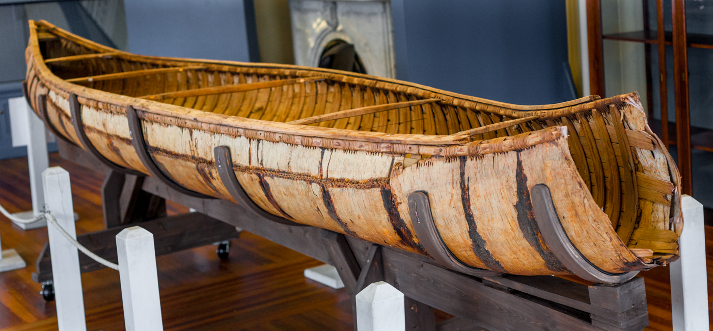
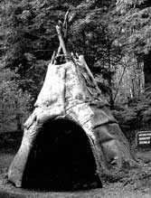
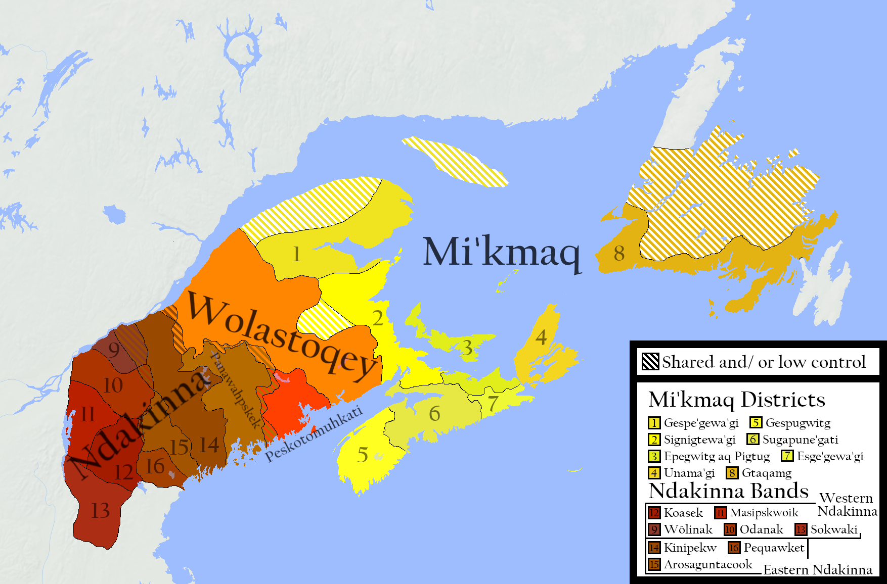

# Au-delà du Grand Nord : Plongée historique et quotidienne dans le monde Wolastoqiyik (Malécite)

Les Wolastoqiyik, signifiant « peuple de la belle et généreuse rivière », sont un peuple algonquien dont l'existence est profondément liée au **Wolastoq** (la rivière Saint-Jean), artère vitale de leur territoire ancestral *Wolastokuk*. Les Européens les ont d'abord appelés « Etchemins », puis « Malécites » — un terme d'origine mi'kmaq signifiant « ceux qui parlent lentement ». Aujourd'hui, la Première Nation Malécite de Viger est la seule bande wolastoqiyik reconnue au Québec.

Le territoire traditionnel *Wolastokuk* s'étend sur environ 55 000 km², depuis les sources de la rivière dans les monts Notre-Dame, à la frontière Québec-Maine, jusqu'à la baie de Fundy. En 2011, l'ensemble du bassin versant a été désigné lieu historique national du Canada, reconnaissant ainsi l'importance spirituelle, culturelle et historique de cette étendue d'eau pour le peuple wolastoqiyik.

## 1. Une économie semi-nomade rythmée par les saisons

* **La chasse, la pêche et l'agriculture :** Les Wolastoqiyik pratiquaient la chasse au cerf et à l'orignal, la pêche au saumon et aux poissons d'eau douce, ainsi que la culture du maïs, des haricots, de la courge et du tabac.
* **La cueillette :** Les femmes récoltaient noix, baies et fruits sauvages, complétant ainsi l'alimentation familiale.
* **Le canot d'écorce de bouleau :** Léger et rapide, il permettait de parcourir le vaste réseau hydrographique du *Wolastokuk* et d'effectuer des portages entre les bassins versants.

Les villages étaient stratégiquement situés au-dessus des plaines inondables, comme à Meductic, tandis que les champs cultivés occupaient les zones plus basses, fertilisées naturellement par les crues printanières. Cette organisation intelligente des ressources permettait une exploitation durable du territoire. Les canots, construits entièrement à partir de matériaux naturels — écorce de bouleau, cèdre, épinette et racines de sapin — pouvaient transporter plusieurs familles et leurs biens sur les 700 km du réseau hydrographique.

## 2. Organisation sociale et confédération Wabanaki

* **Le conseil de bande :** Composé d'un chef de guerre, d'un chef civil et de représentants de chaque famille, il prenait les décisions courantes.
* **Le conseil général de la nation :** Il tranchait les questions de guerre et d'alliance à l'échelle de l'ensemble du peuple wolastoqiyik.
* **La Confédération Wabanaki :** Alliance défensive regroupant les Wolastoqiyik, Abenaki, Passamaquoddy, Penobscot et Mi'kmaq contre l'expansion de la Haudenosaunee.

La Confédération Wabanaki, aussi appelée « peuple de l'aube », constituait une alliance politique et militaire majeure dans la région. Les Wolastoqiyik y occupaient une position centrale en raison de leur contrôle du fleuve Saint-Jean, principale voie de communication intérieure. Les conseils se tenaient dans des lieux de rassemblement comme l'île Kani Uten, près de l'embouchure du fleuve. Cette structure politique complexe a permis aux nations membres de résister à l'expansion de la Confédération Haudenosaunee pendant des siècles.

## 3. Langue, reconnaissance et résilience

* **Wolastoqey latuwewakon** : La langue, très proche du passamaquoddy, est encore parlée dans le Maine et le Nouveau-Brunswick. Au Québec, des projets d'immersion et de transmission intergénérationnelle voient le jour.
* **La reconnaissance de 1989 :** La Assemblée nationale du Québec a officiellement reconnu la Nation malécite comme la onzième nation autochtone du Québec, marquant un tournant politique majeur.
* **La valeur du partage :** La distribution de boîtes de viande et de poisson aux membres dispersés à travers le Québec perpétue aujourd'hui le principe fondamental de solidarité wolastoqiyik.

La langue wolastoqey, ou *Wolastoqey latuwewakon*, appartient à la famille des langues algonquiennes orientales et conserve des liens étroits avec le passamaquoddy. Au Québec, la dispersion géographique des membres — principalement entre Lévis, Rimouski et la région de Rivière-du-Loup — rend la transmission culturelle plus difficile. Pour y remédier, des initiatives comme le séminaire Wahsipekuk, un programme d'immersion culturelle à bord d'un navire-école, permettent aux jeunes de renouer avec leur patrimoine. La cuisine traditionnelle, basée sur les produits de la chasse, de la pêche et de la forêt, joue également un rôle clé dans cette revitalisation.

La Première Nation Malécite de Viger continue de défendre les droits ancestraux de son peuple et de promouvoir la reconnaissance du *Wolastokuk* comme territoire traditionnel. Les défis demeurent nombreux, mais la résilience culturelle et l'attachement à la terre et aux eaux du Wolastoq assurent la pérennité de la nation wolastoqiyik pour les générations futures.

